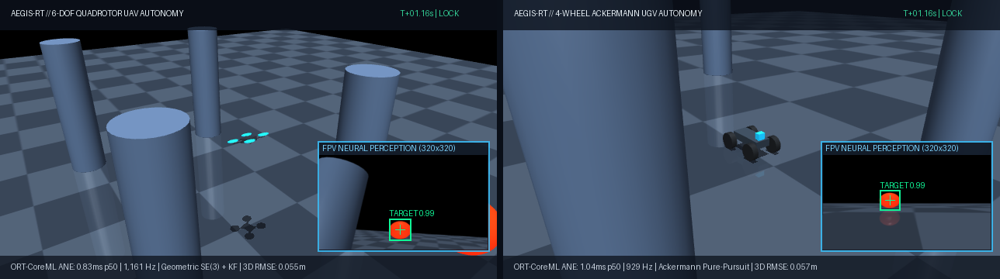
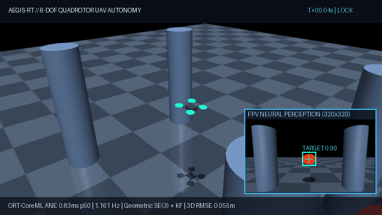
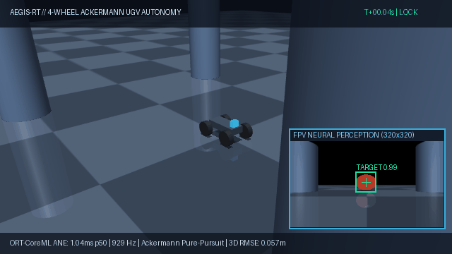
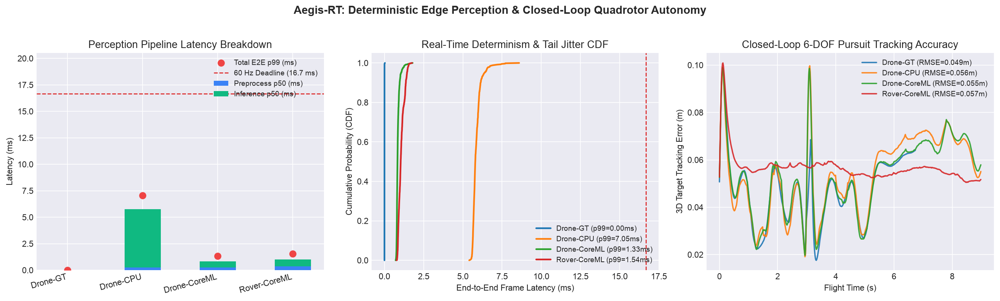
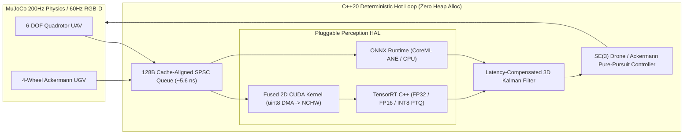

<div align="center">



# Aegis-RT: Deterministic Edge Perception & Multi-Vehicle Autonomy Stack

**Zero-Heap-Allocation C++20 Runtime · Lock-Free SPSC · Custom Fused CUDA Kernel · TensorRT (FP16/INT8) · MuJoCo Closed-Loop Sim**

[](CMakeLists.txt)
[](src/kernels/preprocess.cu)
[](src/backends/trt_backend.cpp)
[](src/sim/mujoco_bridge.cpp)
[](LICENSE)
[](CONTRIBUTING.md)

[**Interactive Showcase (`docs/index.html`)**](https://mahruschow.github.io/aegis-rt/) · [**Quick Start**](#-quick-start-5-minutes) · [**Architecture**](#-system-architecture) · [**Benchmarks**](#-measured-telemetry-benchmarks) · [**About the Author**](#-about-the-author--mahrus-chowdhury)

</div>

---

## Welcome! What is Aegis-RT?

Most robotics and computer-vision demos run Python scripts on pre-recorded video clips without worrying about memory allocations, CPU-to-GPU copy overhead, or tail-latency spikes. In real physical machines—autonomous drones, ground rovers, and flight computers—a single latency spike or dropped frame means missing a turn or clipping an obstacle.

**Aegis-RT** is an open, approachable, end-to-end **hard-real-time C++20 autonomy stack** built from scratch to show how modern neural perception connects to deterministic flight and vehicle control:

* **Dual Autonomous Platforms Out of the Box:** Switch between a **6-DOF Quadrotor Drone (`--vehicle drone`)** and a **4-Wheel Ackermann Rover (`--vehicle rover`)** driven by the **exact same neural network (`AegisNanoDetector`)** and **3D Kalman Filter**.
* **Run Anywhere ($0 Local Dev -> Cloud GPU -> Jetson Edge):** Develop and visualize locally on macOS (CPU / Apple Neural Engine CoreML), profile custom CUDA + TensorRT INT8 engines on any Linux GPU via `Dockerfile.cuda`, and deploy with zero-copy Unified Memory on **NVIDIA Jetson Orin Nano**.
* **100% Open & Friendly:** Clean modern C++20, documented equations, automated unit tests, and zero proprietary dependencies. Clone it, break it, swap in your own robot XML, or open an issue!

---

## Live Closed-Loop Autonomy Demos

<table>
  <tr>
    <td align="center" width="50%">
      <br />
      <strong>6-DOF Quadrotor UAV (<code>--vehicle drone</code>)</strong><br />
      <sub>Geometric <em>SE(3)</em> attitude control + potential-field obstacle avoidance<br /><strong>0.83 ms p50</strong> · <strong>1,161 Hz</strong> · <strong>0.055 m 3D RMSE</strong></sub>
    </td>
    <td align="center" width="50%">
      <br />
      <strong>4-Wheel Ackermann UGV (<code>--vehicle rover</code>)</strong><br />
      <sub>Exact inner/outer Ackermann steering + Pure-Pursuit + torque vectoring<br /><strong>1.04 ms p50</strong> · <strong>929 Hz</strong> · <strong>0.057 m 3D RMSE</strong></sub>
    </td>
  </tr>
</table>

---

## Measured Telemetry Benchmarks

<p align="center">
  
</p>

| Vehicle & Backend | Preprocess (p50 / p99) | Inference (p50 / p99) | Control (p50 / p99) | Total E2E (p50 / p99) | Sustained Rate | 60 Hz Misses (>16.7 ms) | Visual Lock | 3D Tracking RMSE | Min Obstacle Clearance |
| :--- | :---: | :---: | :---: | :---: | :---: | :---: | :---: | :---: | :---: |
| `Quadrotor · GT-Oracle` | — | — | 0.001 / 0.004 ms | 0.001 / 0.004 ms | — | 0 / 450 | 98.0% | **0.049 m** | 0.497 m |
| `Quadrotor · ORT-CPU-FP32` | 0.247 / 0.515 ms | 5.530 / 6.802 ms | 0.001 / 0.005 ms | 5.791 / 7.049 ms | 170.3 Hz | 0 / 600 | **100.0%** | **0.056 m** | 0.488 m |
| `Quadrotor · ORT-CoreML-ANE` | 0.247 / 0.562 ms | **0.578 / 0.914 ms** | 0.001 / 0.004 ms | **0.830 / 1.326 ms** | **1,161.0 Hz** | 0 / 600 | **100.0%** | **0.055 m** | 0.499 m |
| `Ackermann Rover · ORT-CoreML-ANE` | 0.367 / 0.768 ms | **0.651 / 1.051 ms** | 0.002 / 0.019 ms | **1.035 / 1.542 ms** | **929.4 Hz** | 0 / 600 | **100.0%** | **0.057 m** | 0.933 m |

> [!TIP]
> **The Amdahl's Law Discovery Behind `preprocess.cu`:** Accelerating neural inference **9.6x** (`5.530 ms -> 0.578 ms`) causes CPU image preprocessing (`0.247 ms` p50 / `0.562 ms` p99) to jump from **4.3%** of frame latency to **29.8%–42.4%**! That empirical shift is why `src/kernels/preprocess.cu` moves letterboxing, bilinear resize, normalization, and `HWC -> NCHW` transposition onto the GPU using pinned/Unified-Memory DMA.

---

## System Architecture



---

## Interactive Technical Deep-Dives (Click to Expand)

<details>
<summary><strong>1. Lock-Free SPSC Ring Buffer &amp; Cache-Line Isolation (<code>include/aegis/core/spsc_queue.hpp</code>)</strong></summary>
<br />

Standard `std::mutex` + `std::queue` pipelines suffer from OS scheduler wakeups and dynamic heap allocations. `SpscQueue<T, Capacity>` eliminates both:
* **128-Byte Cache-Line Padding (`alignas(128)`):** Isolates producer `tail_` and consumer `head_` atomics across separate L2 cache lines on both x86_64 and Apple Silicon / ARM64 Orin cores to eliminate false sharing.
* **Shadow Index Caching:** Producer caches `cached_head_` and consumer caches `cached_tail_` locally, preventing cross-core MESI cache invalidations until the ring buffer actually nears full or empty.
* **Measured Throughput:** Verified across 500,000 concurrent cross-thread handoffs in `tests/test_spsc_queue.cpp` at **~5.6 ns per message**.

</details>

<details>
<summary><strong>2. Custom Fused 2D CUDA Kernel &amp; Jetson Zero-Copy (<code>src/kernels/preprocess.cu</code>)</strong></summary>
<br />

Instead of running OpenCV `cv::resize` + `cv::cvtColor` + `float32` conversion on the CPU and copying `1.2 MB` of `float32` tensors across PCIe:
1. **4x PCIe Bandwidth Reduction:** Transfers compact raw `uint8_t` camera pixels via pinned DMA host memory (`cudaMallocHost`).
2. **Jetson Orin Unified Memory (`--jetson-zerocopy`):** Uses `cudaHostAllocMapped` so CPU camera capture and GPU CUDA threads address the **exact same physical LPDDR5 memory** with **0 bytes copied**.
3. **Coalesced Planar Writes:** A single 2D thread block `(16, 16)` computes aspect-preserving letterbox bounds, sub-pixel bilinear interpolation via `__ldg()` read-only cache loads, `[0, 1]` normalization, and coalesced planar `CHW` global writes directly into TensorRT's bound input pointer (`< 1e-5` max diff vs. golden CPU reference).

</details>

<details>
<summary><strong>3. Latency-Compensated 3D Kalman Filter &amp; Dual Vehicle Controllers (<code>src/control/</code>)</strong></summary>
<br />

* **OpenGL NDC Depth Linearization & Back-Projection:** Linearizes perspective depth $z_{\text{near}} / (1 - z_{\text{ndc}}(1 - z_{\text{near}}/z_{\text{far}}))$ and back-projects 2D bounding-box centroids through pinhole intrinsics and camera extrinsics into 3D world space.
* **Perception Delay Compensation:** `KalmanTracker3D` compares camera measurements against back-propagated capture-time state $\hat{p}(t_{\text{cap}}) \approx \hat{p}(t) - \hat{v}(t)\Delta t_{\text{perc}}$ with a `3.5 m` innovation outlier gate.
* **6-DOF Quadrotor (`controller.cpp`):** Geometric $SO(3)$ attitude error $e_R = \frac{1}{2}(R_d^T R - R^T R_d)^\vee$ + repulsive obstacle potential fields + 4-rotor X-frame mixer.
* **4-Wheel Ackermann UGV (`rover_controller.cpp`):** Pure-Pursuit lookahead curvature $\kappa = 2 y_b / L_d^2$ + exact inner/outer Ackermann wheel angles $\delta_{L,R} = \arctan\!\left(\frac{W \tan\delta}{W \mp \frac{T}{2}\tan\delta}\right)$ + cornering-modulated rear torque vectoring.

</details>

---

## Quick Start (5 Minutes)

### macOS (Apple Silicon)
```bash
git clone https://github.com/mahruschow/aegis-rt.git
cd aegis-rt
bash scripts/setup_mac.sh

# Capture training/calibration frames & export AegisNanoDetector (.onnx)
./build/aegis_rt --vehicle drone --backend gt --frames 450 --dump-dataset assets/calib_frames
./.venv/bin/python python/export_model.py --dataset-dir assets/calib_frames --out assets/models/aegis_detector.onnx --epochs 40

# Launch live interactive 3D autonomous pursuit (--vehicle rover or --vehicle drone)
./build/aegis_rt --vehicle rover --backend ort-coreml --frames 1200 --gui
./build/aegis_rt --vehicle drone --backend ort-coreml --frames 1200 --gui
```

### Linux Cloud GPU (CUDA 12 + TensorRT 10 + Nsight Systems)
```bash
# Option A: Reproducible Docker container
docker build -f Dockerfile.cuda -t aegis-rt-cuda .
docker run --gpus all --rm -v $(pwd)/results:/workspace/aegis-rt/results aegis-rt-cuda

# Option B: Direct one-click benchmark & Nsight Systems / Compute profiler
bash scripts/cloud_bench.sh
```

### NVIDIA Jetson Orin Nano (Edge Sim-to-Real)
```bash
bash scripts/jetson_power_bench.sh
```

---

## About the Author — Mahrus Chowdhury

<table>
  <tr>
    <td>
      <h3>Hey, I'm Mahrus! 👋</h3>
      <p>
        I'm a <strong>Computer Engineering</strong> student obsessed with building systems where high-performance software meets physical hardware — <strong>real-time autonomous robotics, embedded &amp; edge AI, GPU/CUDA inference optimization, and hardware-software co-design</strong>.
      </p>
      <p>
        I built <strong>Aegis-RT</strong> because I wanted to go deeper than high-level Python wrappers and understand every layer of an autonomous machine's nervous system: how bytes move across cache lines and PCIe/LPDDR5 buses, how INT8 quantization affects closed-loop control stability, and how a single perception stack can generalize across both ground rovers and aerial drones.
      </p>
      <p>
        <strong>What I'm working on next:</strong> Porting Aegis-RT onto physical <strong>NVIDIA Jetson Orin Nano</strong> hardware with live CSI camera feeds, experimenting with speculative/quantized Vision-Language-Action (VLA) policies, and exploring custom FPGA/ASIC matrix accelerators.
      </p>
      <p>
        <a href="https://github.com/mahruschow"></a>
        <a href="mailto:mahhchowdhury@gmail.com"></a>
        <a href="https://mahruschow.github.io/aegis-rt/"></a>
      </p>
    </td>
  </tr>
</table>

<details>
<summary><strong>🛠 My Technical Toolbox &amp; Interests (Click to Expand)</strong></summary>
<br />

* **Systems & Languages:** Modern C++ (`C++17/20`), CUDA C++, Python, C, Embedded Linux, Bash, CMake/Ninja
* **AI Inference & Acceleration:** NVIDIA TensorRT (`FP16` / `INT8` PTQ), ONNX Runtime, Apple CoreML/ANE, PyTorch, Nsight Systems & Compute
* **Robotics & Control:** MuJoCo, State Estimation (Kalman Filtering), Geometric $SE(3)$ UAV Control, Ackermann Kinematics & Pure-Pursuit, Potential-Field Planning
* **Computer Engineering:** Lock-Free Concurrency, Memory Hierarchy & DMA (`cudaMallocHost` / Unified Memory), Digital Logic / Computer Architecture

</details>

---

## Contributing & Community

Have an idea, found a bug, or want to use **Aegis-RT** as a template for your own robotics or CUDA project? **Please do!** Check out [CONTRIBUTING.md](CONTRIBUTING.md) or open an Issue — stars, forks, and discussions are always appreciated. Licensed under the [MIT License](LICENSE).
